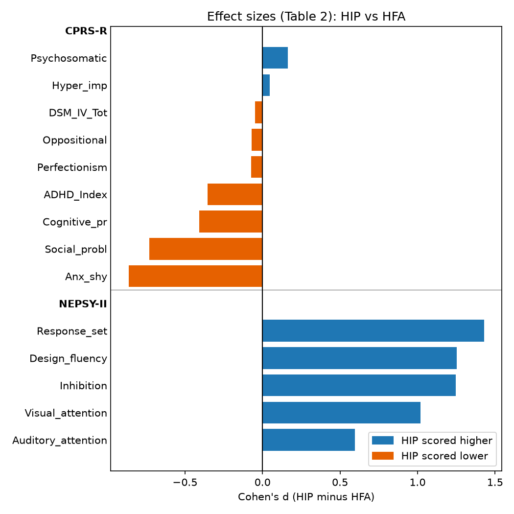
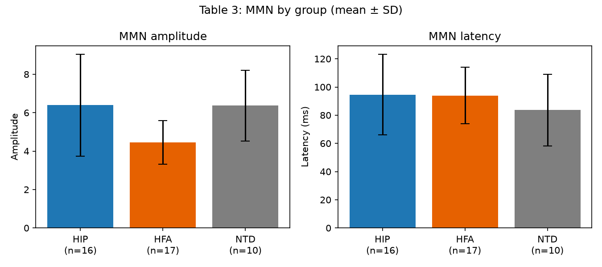

# High Intellectual Potential and High Functioning Autism: Data Analysis

Riccioni et al. (2021). "High Intellectual Potential and High Functioning Autism: Clinical and Neurophysiological Features in a Pediatric Sample". Brain Sciences, 11(12), 1607. https://doi.org/10.3390/brainsci11121607

## Goal
Learn data analysis and the functioning of GitHub by exploring data of personal interest. This is an independent learning project, not a clinical or medical interpretation of the paper.

## Glossary
- **HIP:** high intellectual potential
- **HFA:** high functioning autism
- **NTD:** neurotypical development, the comparison group
- **Cohen's d:** effect size, the difference between two groups measured in standard deviations
- **CPRS-R:** Conners' Parent Rating Scale-Revised, a parent-report questionnaire
- **NEPSY-II:** neuropsychological tests of attention and executive functions
- **MMN:** mismatch negativity, an EEG component measured in the paper
- **P300:** an EEG component measured in the paper

## What this project currently does
- Stores the summary values of Table 1 of the paper (means, standard deviations and group sizes for HIP, HFA and NTD on cognitive, adaptive and autistic symptom measures). The values were typed by hand and checked against the paper.
- Recomputes Cohen's d for HIP vs. HFA and compares it with the paper's values (all within 0.02).
- Plots the ADOS-2 Calibrated Severity Score by group.
- Charts Cohen's d for all 18 measures, grouped by test.
- Stores the summary values of Table 2 (CPRS-R and NEPSY-II) and Table 3 (MMN and P300), plus the p-values and Cohen's d the paper reports for HIP vs. HFA.
- Recomputes Cohen's d and the t-test p-value for HIP vs. HFA on Tables 2 and 3 and compares them with the reported values (see "Consistency check" below).
- Plots the Table 2 effect sizes and the Table 3 MMN values by group.






## Files
- `data/table1_summary.csv`: Table 1 summary data
- `analysis/01_load_and_pivot.py`: loads the data and reshapes it
- `analysis/02_cohens_d.py`: recomputes effect sizes
- `analysis/03_plot_ados_css.py`: makes the ADOS CSS bar chart
- `analysis/04_plot_effect_sizes.py`: makes the effect size chart
- `data/table2_summary.csv`: Table 2 summary data (CPRS-R and NEPSY-II)
- `data/table3_summary.csv`: Table 3 summary data (MMN and P300)
- `data/reported_stats_hip_vs_hfa.csv`: p-values and Cohen's d reported in the paper for HIP vs. HFA (Tables 2 and 3)
- `analysis/05_check_tables_2_3.py`: recomputes d and p for Tables 2 and 3 and compares them with the reported values
- `analysis/06_plot_tables_2_3.py`: makes the Table 2 effect size chart and the Table 3 MMN chart
- `results/table2_3_consistency_check.csv`: output of the consistency check
- `figures/effect_sizes_table2.png`: Table 2 effect sizes, grouped by CPRS-R and NEPSY-II
- `figures/mmn_table3.png`: MMN amplitude and latency by group

## How to run
Install the libraries, then run any script:

```
pip install pandas matplotlib scipy
python analysis/02_cohens_d.py
```

`scipy` is only needed for `analysis/05_check_tables_2_3.py`.

## Limits
The data are group summaries (averages and standard deviations) from a small sample (HIP n=16, HFA n=17, NTD n=10), not individual records. The results describe this paper's sample and do not show anything about individual children.
- Response set values were assigned to HIP and HFA by inference, because the table was cut off in the source page.
- Table 3 sample sizes were assumed equal to Tables 1 and 2.
- P300 has means only (no SDs), so it is not included in the consistency check or the charts.

## Consistency check
`analysis/05_check_tables_2_3.py` recomputed Cohen's d and the p-value (two-sided t-test, equal variances) for 16 HIP vs. HFA measures from the printed means, SDs and group sizes. 2 of the 16 reported values could not be reproduced:
- Cognitive_pr: recomputed d = -0.41, reported d = -0.04 (the p-value matches).
- Design_fluency: recomputed p = 0.001, reported p = 0.307 (the d matches).

This may reflect typos in the published table, rounding, a different statistical test, or an error in my transcription.
