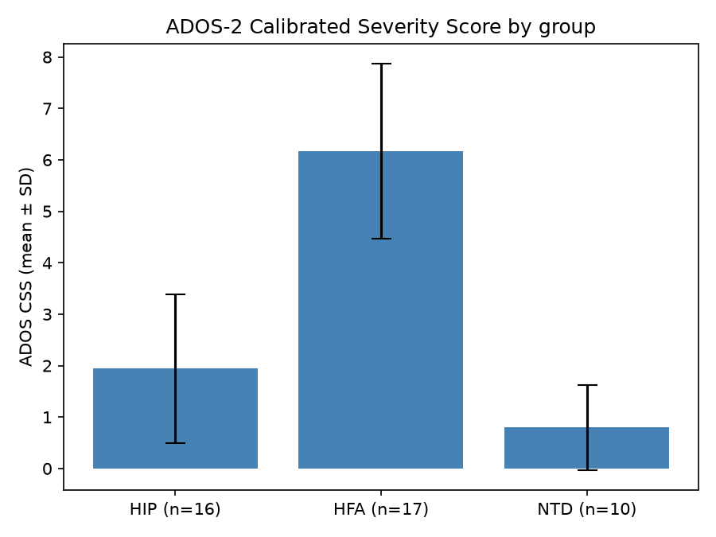
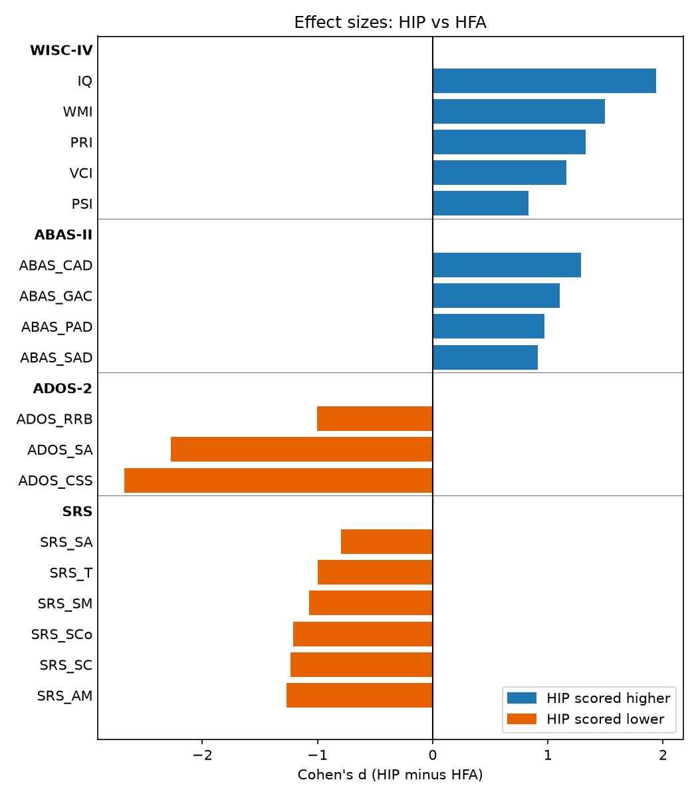

# High Intellectual Potential and High Functioning Autism: Data Analysis

Riccioni et al. (2021). "High Intellectual Potential and High Functioning Autism: Clinical and Neurophysiological Features in a Pediatric Sample". Brain Sciences, 11(12), 1607. https://doi.org/10.3390/brainsci11121607

## Goal
Learn data analysis and the functioning of GitHub by exploring data of personal interest. This is an independent learning project, not a clinical or medical interpretation of the paper.

## Glossary
- **HIP:** high intellectual potential
- **HFA:** high functioning autism
- **NTD:** neurotypical development, the comparison group
- **Cohen's d:** effect size, the difference between two groups measured in standard deviations

## What this project currently does
- Stores the summary values of Table 1 of the paper (means, standard deviations and group sizes for HIP, HFA and NTD on cognitive, adaptive and autistic symptom measures). The values were typed by hand and checked against the paper.
- Recomputes Cohen's d for HIP vs. HFA and compares it with the paper's values (all within 0.02).
- Plots the ADOS-2 Calibrated Severity Score by group.
- Charts Cohen's d for all 18 measures, grouped by test.





## Files
- `data/table1_summary.csv`: Table 1 summary data
- `analysis/01_load_and_pivot.py`: loads the data and reshapes it
- `analysis/02_cohens_d.py`: recomputes effect sizes
- `analysis/03_plot_ados_css.py`: makes the ADOS CSS bar chart
- `analysis/04_plot_effect_sizes.py`: makes the effect size chart

## How to run
Install the libraries, then run any script:

```
pip install pandas matplotlib
python analysis/02_cohens_d.py
```

## Limits
The data are group summaries (averages and standard deviations) from a small sample (HIP n=16, HFA n=17, NTD n=10), not individual records. The results describe this paper's sample and do not show anything about individual children.
